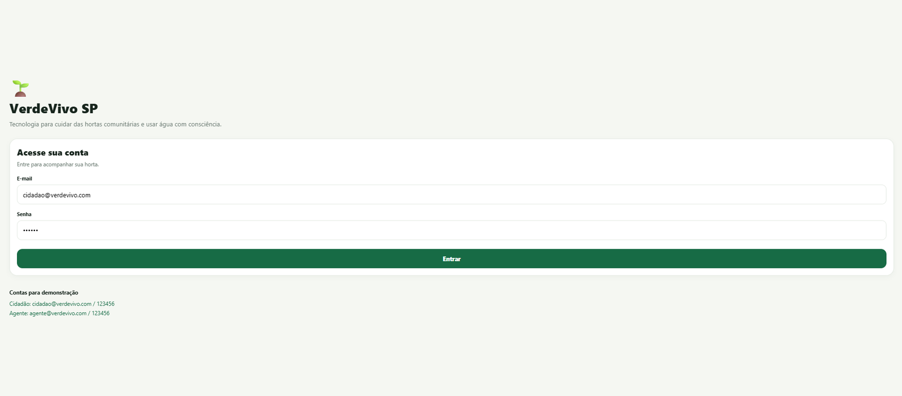
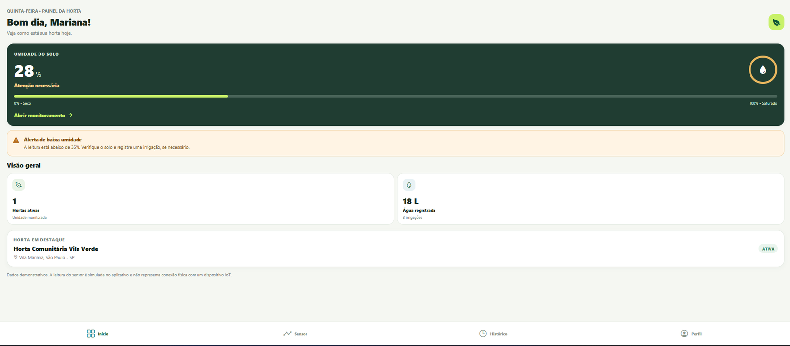
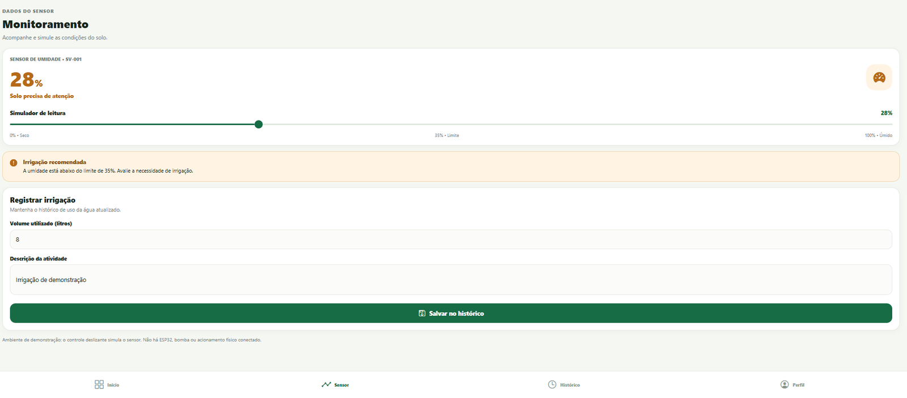
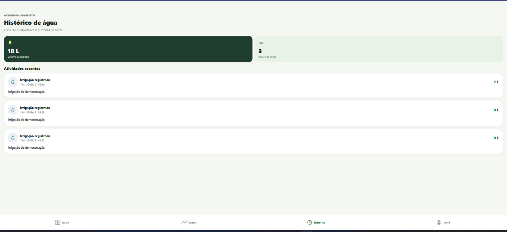
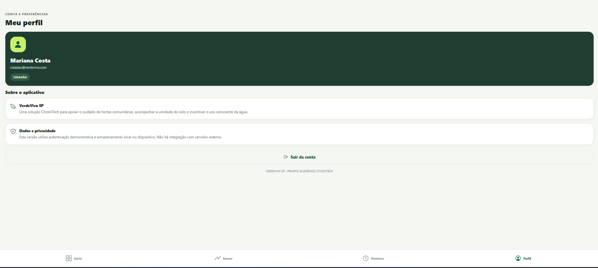

# 🌱 VerdeVivo SP — CitizenTech

Aplicativo acadêmico desenvolvido em React Native para apoiar o cuidado de hortas comunitárias por meio do monitoramento simulado da umidade do solo, geração de alertas e registro de irrigação, incentivando o uso consciente da água.

## 👥 Integrantes

- **Luiz Felipe Motta da Silva** — RM 559126
- **Nicolas Lorenzo Ferreira da Silva** — RM 557962
- **Pedro Henrique Faim dos Santos** — RM 557440

## 🎥 Vídeo de demonstração

Confira a apresentação e o funcionamento do aplicativo:

[▶️ Assistir ao vídeo de demonstração no YouTube](https://youtu.be/gJFUU_OL9zU)

## 📋 Ficha CitizenTech

### Problema

Hortas comunitárias podem depender de irrigação manual sem informações precisas sobre a umidade do solo, o que pode ocasionar desperdício de água ou falta de irrigação adequada.

### Público beneficiado

- Moradores.
- Voluntários.
- Responsáveis por hortas comunitárias.
- Agentes comunitários.

### Hipóteses

1. A visualização simples da umidade ajuda os responsáveis a identificar quando o solo pode precisar de água.
2. Alertas baseados em limites de umidade podem apoiar decisões de irrigação.
3. O registro das irrigações ajuda a acompanhar as atividades da horta.

### Indicadores propostos

- Quantidade de alertas de solo seco gerados.
- Quantidade de registros de irrigação realizados.
- Percentual de leituras simuladas abaixo do limite de 35%.
- Frequência de uso do monitoramento.

> Os indicadores são propostas de acompanhamento. Este protótipo não mede impacto real nem está conectado a sensores físicos.

## 📱 Demonstração visual

### 1. Tela de login



### 2. Dashboard



### 3. Monitoramento da umidade



### 4. Histórico de irrigação



### 5. Perfil do usuário



## ⚙️ Funcionalidades

- Login demonstrativo com perfis de cidadão e agente comunitário.
- Context API para gerenciamento do estado de autenticação.
- Navegação entre telas utilizando Expo Router.
- Dashboard com informações sobre a umidade do solo.
- Simulação IoT ajustável por controle deslizante.
- Alertas automáticos quando a umidade está abaixo de 35%.
- Registro de irrigação com quantidade de água e descrição da atividade.
- Histórico de irrigação com total de litros utilizados e registros realizados.
- Persistência local de dados utilizando AsyncStorage.
- Validação básica de e-mail e senha.
- Validação da quantidade de água informada, aceitando somente números e valores entre 1 e 500 litros.

## 🔐 Contas para demonstração

O aplicativo disponibiliza duas contas demonstrativas:

| Perfil | E-mail | Senha |
|---|---|---|
| Cidadão | cidadao@verdevivo.com | 123456 |
| Agente comunitário | agente@verdevivo.com | 123456 |

**Observação:** a autenticação é simulada localmente para fins acadêmicos. Não existe servidor externo ou autenticação segura de produção.

## 💻 Tecnologias utilizadas

- React Native
- Expo
- TypeScript
- Expo Router
- Context API
- AsyncStorage
- JavaScript

## 🚀 Como instalar e executar

### Pré-requisitos

- Node.js LTS instalado.
- VS Code ou outro editor de código.
- Expo Go instalado no celular, caso queira testar no dispositivo físico.

### Instalação

1. Clone o repositório:

```bash
git clone https://github.com/lzFelipee/VerdeVivoSP.git
```

2. Entre na pasta do projeto:

```bash
cd VerdeVivoSP
```

3. Instale as dependências:

```bash
npm install
```

4. Verifique e ajuste as dependências do Expo:

```bash
npx expo install --fix
```

5. Inicie o aplicativo:

```bash
npx expo start
```

6. Para executar no celular, abra o Expo Go e leia o QR Code exibido no terminal.

Também é possível executar em um emulador Android com:

```bash
npm run android
```

Nesse caso, é necessário ter o ambiente Android configurado.

## 📂 Estrutura do projeto

```text
VerdeVivoSP/
│
├── app/
│   ├── (tabs)/
│   │   ├── _layout.tsx
│   │   ├── historico.tsx
│   │   ├── index.tsx
│   │   ├── monitoramento.tsx
│   │   └── perfil.tsx
│   ├── _layout.tsx
│   ├── index.tsx
│   └── login.tsx
│
├── assets/
│   └── screenshots/
│       ├── 01-login.png
│       ├── 02-dashboard.png
│       ├── 03-monitoramento.png
│       ├── 04-historico.png
│       └── 05-perfil.png
│
├── src/
│   ├── components/
│   ├── contexts/
│   ├── hooks/
│   ├── services/
│   ├── styles/
│   └── types/
│
├── .gitignore
├── app.json
├── package.json
├── package-lock.json
├── README.md
└── tsconfig.json
```

## 🌿 Simulação IoT

A tela de monitoramento permite ajustar a umidade simulada do solo entre 0% e 100%, utilizando um controle deslizante.

O aplicativo considera o limite de 35% para identificar situações de baixa umidade:

- **Abaixo de 35%:** apresenta alerta de solo seco e recomendação de irrigação.
- **A partir de 35%:** indica que a umidade está dentro da faixa considerada adequada pelo protótipo.

O usuário também pode registrar uma irrigação informando o volume de água utilizado e uma descrição da atividade. Esses registros ficam armazenados localmente e podem ser consultados na tela de histórico.

### Limitações da simulação

A leitura de umidade é simulada dentro do próprio aplicativo. Não existe comunicação real com o ESP32, sensores físicos ou acionamento de bomba de irrigação.

## 🔒 Dados e privacidade

Esta versão utiliza autenticação demonstrativa e armazenamento local no dispositivo por meio do AsyncStorage. Não há integração com servidor externo.

Os dados de hortas e sensores utilizados no projeto são fictícios ou simulados.

## 🎓 Observação acadêmica

Projeto desenvolvido para atividade acadêmica CitizenTech, com o objetivo de demonstrar como a tecnologia pode apoiar o monitoramento de hortas comunitárias e incentivar o uso consciente da água.
